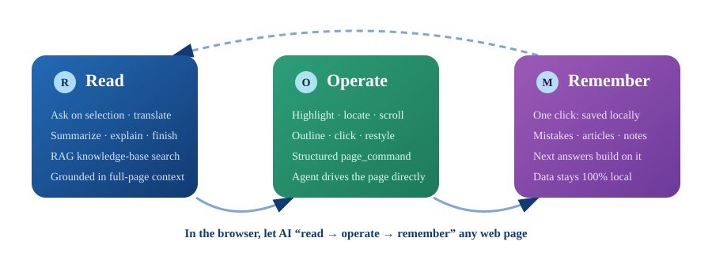
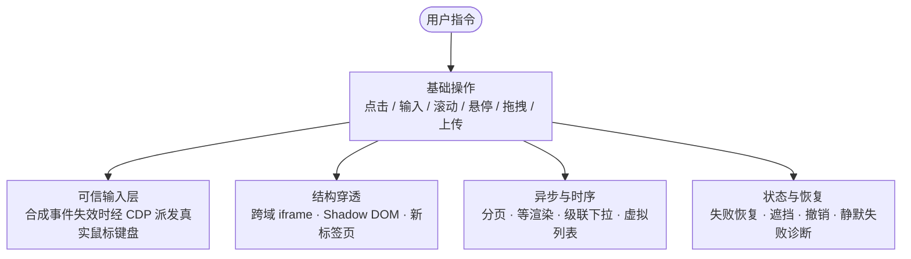
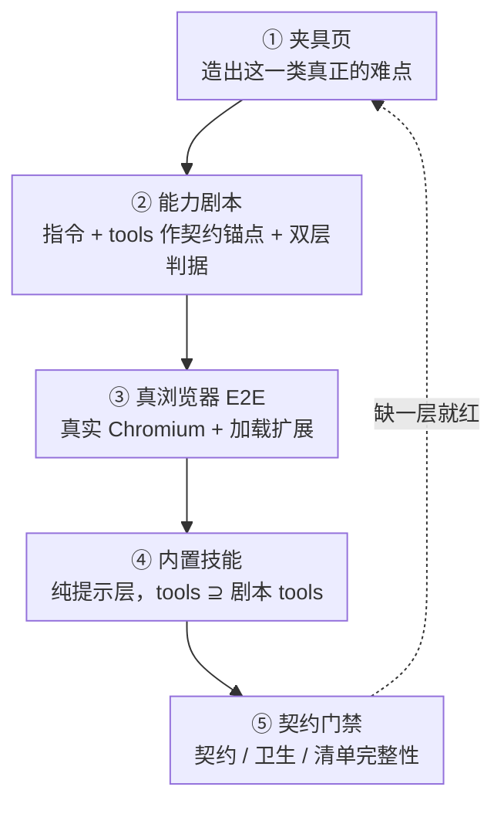
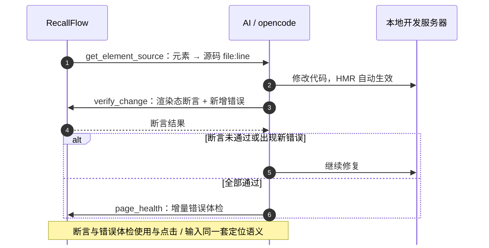

<p align="center">
  
</p>

# RecallFlow

**运行在浏览器中的 AI 助手**：在任意网页上完成「读 → 操作 → 记忆」的闭环。

[](LICENSE)
[](https://www.microsoft.com/edge)
[](manifest.json)
[](https://github.com/marioyyds/RecallFlow)



不是把 HTML 塞给模型，而是**在真实浏览器会话里读页面、动页面**：SPA、登录态、内网页面都能读能操作，
合成事件失效时经 CDP 派发**可信事件**。数据全部保存在本地；除自配的 DeepSeek API Key 外，
仅在使用 SkillHub 检索技能时访问 `skillhub.cn`。

## 操作网页：能力全景

难点不在「能不能点」，而在页面用各种方式让"看起来点到了"与"真的生效了"分家。



| 能力类别 | 真正的难点 | 怎么解 |
| --- | --- | --- |
| **元素定位** | 快照里的 ref 会随渲染失效 | `ref → role+name → testid → text → css` 逐级回退；**站点记忆复用已验证的选择器** |
| **可信输入** | 合成事件不冒泡，canvas 上的按钮点不动 | 经 `chrome.debugger` 派发真实输入；`get_ax_snapshot` 取视口坐标再 `click_at` |
| **结构穿透** | 目标在跨域 iframe 或 shadow root 里 | 复合 ref `f<frameId>:rf-N` 路由；**穿透 iframe 与 Shadow DOM**（命中判定同样穿透） |
| **异步与时序** | 翻页/级联常是"先清空、过会儿才填" | 先 `wait_for_element` 再读；等 `state:"enabled"` 而不是 `visible` |
| **跨页与跨域** | 落错标签页不会报错 | 新标签页自动接管并明写「已自动绑定」；搬运类判据两头看（目标页收到 + 来源页纹丝不动） |
| **状态与恢复** | 失败原因往往不在页面上 | 读懂拒绝原因再重试；**撤销可回退输入 / 勾选 / 选择 / 样式 / 滚动**（⚠ 点击与导航不可撤销） |
| **静默失败诊断** | HTML5 校验拦住提交时页面上什么都没有 | `inspect_element({op:"inspect"})` 报出未通过字段与**与语言无关的约束名** |
| **记忆与技能** | 重复劳动不该再花 token | **四类知识库**（标记 / 标签 / 搜索 / 导入导出，Agent 可读写）；**技能中心增删改查与导入导出**；宏按站点零 token 回放 |
| **扩展与安全** | 能力要能长，权限要能收 | 用户脚本运行时（含**权限预览**）；**MCP 客户端**（连接远程 MCP 服务器，工具并入 Agent）；写操作逐次审批或按类别自动批准 |

**24 类复杂场景**按同一形状逐条沉淀 —— 遮挡弹层、失败恢复、跨域 iframe、分页 / 异步、
合并单元格表格、新标签页接管、Shadow DOM 穿透、canvas 坐标点击、CDP 拖拽、虚拟列表、
级联下拉、宏保存回放、文件上传、跨标签页搬运、知识库往返与召回边界、严格 CSP 页面世界执行、
撤销、表单原生校验……逐条见 **[能力清单](docs/capability-inventory.md)**。

## E2E 测试架构

每个能力都按**同一形状**沉淀，缺任何一层都会被门禁拦下 —— 这是本仓库最花力气的地方。



| 层 | 是什么 | 怎么被验收 |
| --- | --- | --- |
| ① 夹具页 | 造出**真难点**，不是"能跑通"的简化页 | 页面自身记录可断言的标志（如"提交被拦住"） |
| ② 能力剧本 | 指令 + `tools` + **双层判据** | 触发词唯一、指令与 spec 逐字一致、夹具路由已接线 |
| ③ 真浏览器 E2E | Playwright + 真实 Chromium | 脚本化路径 + 真模型 eval，两条各管一段 |
| ④ 内置技能 | 不改工具签名，只给提示 | 技能 `tools` 必须**覆盖**剧本 `tools` |
| ⑤ 门禁 | 静态契约与完整性 | 缺件、漂移、声明过头，都会红 |

### 判据分两层，缺一不可

| 层 | 问的问题 | 例子 |
| --- | --- | --- |
| **页面状态** | 页面真的变了吗 | 页面自己的标志位、回执文案、控件值 |
| **模型收到了什么** | 证据真的到模型手里了吗 | 工具结果里必须出现某个只可能来自页面的串 |

只断言前者会漏掉"读到了但没送到模型"；只断言后者会漏掉"模型自己编了个像样的答案"。
两者合起来才能排除"看起来做完了"。

### 两种跑法，各管一段

| | 脚本化 E2E（进 CI） | 真模型 eval（不进 CI：要花钱、不确定） |
| --- | --- | --- |
| 模型 | 夹具代理按剧本返回固定 `tool_calls` | 真调 `deepseek-chat` |
| 能证明 | **能力存在**，且路径由我们控制、可断言细节 | **技能文案真的能用**，模型会不会自己找到路 |
| 不能证明 | 技能文案好不好用 | 稳定复现 |

真模型 eval 反复推翻过想当然：拖拽终点该选**刻度**而不是容器、虚拟列表该滚**容器**而不是窗口、
读下拉选项该用 `inspect_element({op:"options"})` 而不是 `run_javascript`（审批 1 → 0、调用 6 → 4）。
**同一场景时会好时坏** —— 判据错就改判据，模型没做完就照实记一次失败，两者不混。

### 现在的规模

| | 数量 |
| --- | --- |
| 能力剧本（与夹具页、技能一一对应） | **27** |
| 真浏览器 E2E 场景 | **37** |
| 页面状态判据 / 模型回执判据 | **74 / 51** 条 |
| 单元测试与门禁 | **1324** 项单元测试（101 个文件） |

```bash
npm test          # 单元测试 + 三道独立脚本门禁 + 刷新测试数快照
npm run test:e2e  # 真实 Chromium：加载扩展 + 夹具代理 LLM
npm run build:content
```

- **`npm run test:e2e` 必须非 headless** —— headless 下 MV3 扩展的 service worker 不会注册。
- **三道独立脚本门禁**：对 const 赋值 / 请求前缀稳定性 / **变异测试**（专门验证"其它断言是否真有牙齿"）。
- **测试数字由脚本生成，不要手写** —— 本仓库曾同时在三份文档里写着 562 / 382 / 526 三个互相矛盾且都不正确的数字。
- 另有**以单测形式存在**的门禁：工具注册表指纹（搬运式重构的等价性证明）、文档与工作树不漂移、
  能力清单与产物一致、README 声明 ↔ 代码锚点。
- **E2E 怎么写**：[完整指南](docs/e2e-testing-guide.md)（原理 / 操作手册 / 踩过的坑 / 验不了什么）
  与 [目录速查](tests/e2e/README.md)。

## 架构


**三层能力分工**：内置工具 / MCP / 技能职责分离，技能为纯提示层，不改变工具签名。

## Agent 设计


- **失败软着陆**：重复调用、连续失败或无进展时，只摘除问题工具并注入反思继续；仅在跨工具持续无进展或预算触顶时收尾。
- **统一注册表**：模型工具列表、权限策略与参数校验共用一份定义。
- **上下文与用量**：过大的工具结果自动截断并暂存全文（`expand_result` 分段取回），较早结果滚动折叠。
- **可观测性**：逐轮记录缓存命中率与耗时分段（网络 / 预填充 / 生成 / 工具执行），保留含步骤、工具、耗时与错误码的运行轨迹。
- **可靠性**：会话恢复、卡死检测、动作前后快照校验，SPA 异步渲染的变化同样可捕获。

## 快速上手

1. **安装**：Edge 打开 `edge://extensions/`，启用「开发人员模式」→「加载解压缩的扩展」→ 指向本目录。
2. **配置**：点击扩展图标 → 设置，填入 DeepSeek API Key（未配置时知识库仍可正常使用）。
3. **使用**：选中网页文字 → 点「RecallFlow」气泡 → 输入指令，或直接选用快捷语句。

## 前端调试闭环

前端问题的难点不在改代码，而在**确认改对了**。RecallFlow 是这个闭环的验证端：



`verify_change` 支持 `present / count / visible / text / value / minWidth / minHeight / styles`，
跨域 iframe 内元素同样适用。需先 `dev_session_set({ projectRoot, devUrl })`，
源码位置才会由开发服务器 URL 转换为磁盘绝对路径。

## 与 MCP 客户端集成

> **集成路线的唯一事实来源是 [docs/integration-status.md](docs/integration-status.md)** ——
> 它以代码与测试为准，并区分「已实现并验证」与「仅存在于文档、本仓库无法保证」的部分。

`webfetch` 读不到的 SPA、登录态或内网页面，交由 RecallFlow 以真实浏览器会话读取，
返回带时间戳与哈希的证据。共 **13 个工具**（12 个只读 + 1 个受白名单约束的写通道）：

| 分类 | 工具 |
| --- | --- |
| 会话与证据 | `browser_read`、`page_screenshot`、`evidence_get`、`recallflow_session` |
| 运行时诊断 | `read_diagnostics`（console / network / downloads）、`page_health`、`verify_change` |
| 页面与源码 | `get_element_source`、`get_picked_element` |
| 开发上下文 | `dev_session_get`、`dev_session_set` |
| **页面操作（唯一写通道）** | `page_action` —— 点击 / 输入 / 按键 / 滚动 / 等待 / 下拉 / 勾选 / 取快照 |

`page_action` 让外部 agent **能碰页面**：没有它，调试闭环断在"无法触发交互"上（复现不了 bug、
也验证不了修复）。它只开放白名单内的调试必需操作；**任意代码执行、用户脚本、文件上传、
本地数据写入一律拒绝** —— 这些只能在浏览器面板里由用户当次批准（桥接是独立入口，
不经过 agent 循环的审批，因此必须有自己的许可清单 `lib/shared/bridge-write-policy.js`）。

传输有 stdio 与 Streamable HTTP 两种：**stdio 是 1:1**，N 个客户端各起一个 server 进程，
而扩展只能连占用桥接端口的那个，故仅一个实例能读页面；**多实例并发请用 HTTP 模式**。
配置 remote 时**必须显式设置 `timeout`**（opencode 默认 5000 ms，而这些工具可能要等数十秒）。
安装与配置见 [recallflow-mcp/README.md](integrations/opencode/recallflow-mcp/README.md)。

### 会话交接（把面板现场交给外部 AI）

点击对话面板的会话标识芯片即可复制一段交接指令：接收方凭 `RF-XXXXXX` 标识取回
**面板对话 + 页面信息 + 拾取元素 + 控制台错误快照**。错误在事后往往已无法复现，
所以快照在**复制那一刻**落盘 —— 它通常是最关键的证据。标识用无歧义字母表（不含 `0 / O / 1 / I / L`），
最多保留最近 30 份。

复制出来的指令**刻意不点名具体工具**：会话读取工具的名字随集成而变（opencode 侧是
`recallflow_session`，DSH 侧是 `recallflow_browser` 的 `handoff_get`），写死哪一个都会让
其它客户端拿到一段无法执行的文本。触发点是标识本身，并附退路：接收方若没有该能力，
会请你改用面板的「导出记录」粘贴原文。

## 关键文档导航

| 想了解 | 看这里 |
| --- | --- |
| **24 类能力各由什么保证**（夹具页 / 剧本 / E2E / 技能 / 判据） | [docs/capability-inventory.md](docs/capability-inventory.md)（自动生成） |
| **真浏览器 E2E 怎么写**（原理 / 操作手册 / 踩过的坑 / 验不了什么） | [docs/e2e-testing-guide.md](docs/e2e-testing-guide.md)（速查：[tests/e2e/README.md](tests/e2e/README.md)） |
| 接手继续开发（剩什么、为什么没做、怎么开始） | [docs/next-steps-handoff.md](docs/next-steps-handoff.md) |
| 最近一轮改了什么、怎么验证的 | [docs/change-delivery-summary.md](docs/change-delivery-summary.md) |
| 集成路线到底实现了哪些（唯一事实来源） | [docs/integration-status.md](docs/integration-status.md) |
| 新增 / 重构工具时必须遵守的规范 | [docs/tool-design.md](docs/tool-design.md) |

## 项目结构

```text
bookmark-sorter/
├── manifest.json / background.js / content.js   # MV3 扩展骨架（content.js 由 scripts/ 构建）
├── popup.js / options.js / manager.js           # 弹窗 / 设置 / 知识库管理页
├── lib/
│   ├── shared/      # 存储、设置、RAG、常量、会话交接包、通用工具
│   ├── assistant/   # Agent 循环、工具注册表、意图路由、MCP、工具守卫、校验器、技能
│   ├── bridge/      # RecallFlow ↔ 外部 AI 的本地中继
│   ├── backend/     # 浏览器级输入层（CDP：可信事件 / 截图 / 可访问性树 / 页面世界执行）
│   └── page/        # 正文提取、感知快照、页面命令、对话面板与渲染
├── scripts/                 # 静态门禁、构建辅助、能力清单生成
├── tests/                   # 单元测试（node --test）+ E2E 黄金任务（Playwright）
├── integrations/opencode/   # 证据 MCP（server / 配套技能 / 工具契约）
└── docs/                    # 设计规范与文档配图
```

## License

[MIT](LICENSE)
