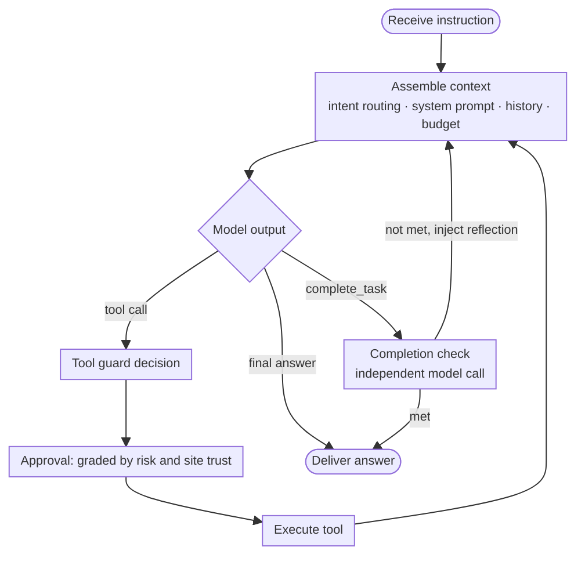

**English** | [中文](README.zh-CN.md)

<p align="center">
  
</p>

# RecallFlow

**Your browser office assistant**: it can operate **every element** on a web page — read, click, fill, drag, upload, paginate, carry data across pages. Hand the repetitive web work over to it.

[](LICENSE)
[](https://www.microsoft.com/edge)
[](manifest.json)
[](https://github.com/marioyyds/RecallFlow)


## What it is

RecallFlow does not shove HTML at a model — it **acts inside your real browser**: logged-in sessions, SPAs and intranet pages are all readable and operable;
when synthesized events fall short, it dispatches **trusted events** over CDP. It remembers and reuses (site memory / skills / macros),
and keeps all data local — apart from your own DeepSeek API Key, the only outbound call is `skillhub.cn`, and only when you search skills on SkillHub.

## Real execution

Inside the extension panel, the Agent (your own DeepSeek key) works on real pages; the right column is the tool log growing step by step.

| Scenario | Recording |
| --- | --- |
| Auto-publishing to Xiaohongshu: open the composer, fill title and body, insert images, add topics, click publish |  |
| Page operations: click / type / submit on a real page |  |
| Search on the current page: find a target in the page and jump to the result |  |
| Mark up what matters: highlight / annotate key information on the page |  |

> All are **speeded-up replays**; third-party sites require login, so these are real-world demos and are not covered by automated tests.

## Core capabilities

The target is **every element on a web page**: cross-origin iframes, Shadow DOM, canvas, virtual lists, custom date pickers,
upload / drag-and-drop / cascading selects, pagination and infinite scroll… Difficulty and per-item guarantees live in the **[capability inventory](docs/capability-inventory.md)**.

## Quick start

1. **Install**: in Chrome or Edge, open `chrome://extensions/` (Chrome) or `edge://extensions/` (Edge), enable "Developer mode" → "Load unpacked" → point at this directory.
2. **Configure**: click the extension icon → Settings, fill in your DeepSeek API Key (the knowledge base still works without it).
3. **Use**: open a page → click the "RecallFlow" bubble on the right → type an instruction, or pick a quick phrase.
4. **Local pages (optional)**: to let it also operate local HTML you opened by double-clicking, go to `chrome://extensions/` (Chrome) or `edge://extensions/` (Edge) → this extension → Details → turn on
   **"Allow access to file URLs"**. After that, local pages behave like any web page (the floating ball appears on open), and saving/printing will not write the extension icon into your file
   (details and acceptance criteria in [docs/local-page-support.md](docs/local-page-support.md)).

## Agent design



- **Failure soft landing**: on repeated calls, consecutive failures or no progress, the guard **only injects reflection suggestions and does not remove tools** (taking a tool away is deciding for the model); it wraps up only when there is sustained no-progress across tools or the budget is exhausted.
- **Unified registry**: the model's tool list, permission policy and parameter validation share a single definition.
- **Context and usage**: oversized tool results are truncated and the full text is stashed (`expand_result` retrieves it in segments); earlier results are folded as the conversation rolls.
- **Observability**: per-round cache hit rate and latency breakdown (network / prefill / generation / tool execution), plus a run trace with steps, tools, timings and error codes.
- **Reliability**: sessions shared across the whole browser (IndexedDB persistence / new / history / cross-tab streaming follow / run lock), session recovery, stall detection, before-and-after action snapshot verification — SPA async re-renders are captured too.

## Integrating with external AI (MCP)

SPAs, logged-in pages or intranet pages that `webfetch` cannot read are handed to RecallFlow, which reads them over a real browser session and returns evidence with timestamps and hashes;
external agents can also touch the page through the single write channel `page_action`, forming a "read → change → verify" front-end debugging loop.
The **single source of truth** for the integration roadmap is [docs/integration-status.md](docs/integration-status.md);
installation and configuration are in [recallflow-mcp/README.md](integrations/opencode/recallflow-mcp/README.md).

## Documentation map

| Want to know | Read this |
| --- | --- |
| What guarantees each capability (fixture pages / scripts / E2E / skills / criteria, auto-generated) | [docs/capability-inventory.md](docs/capability-inventory.md) |
| Skill inventory (skills / script ownership / orphans / thin skills, auto-generated) | [docs/skills-overview.md](docs/skills-overview.md) |
| How the runtime actually picks a skill | [docs/skill-design.md](docs/skill-design.md) |
| How panel sessions are shared, switched and run-locked | [docs/panel-sessions.md](docs/panel-sessions.md) |
| How to write real-browser E2E | [docs/e2e-testing-guide.md](docs/e2e-testing-guide.md) (cheat sheet: [tests/e2e/README.md](tests/e2e/README.md)) |
| How to run a real-model eval, and past results | [docs/real-model-eval-log.md](docs/real-model-eval-log.md) |
| How to run and score the WebArena task-level benchmark | [docs/webarena-eval.md](docs/webarena-eval.md) (results: [docs/webarena-eval-report.md](docs/webarena-eval-report.md)) |
| What the integration roadmap actually delivered (single source of truth) | [docs/integration-status.md](docs/integration-status.md) |
| Rules you must follow when adding / refactoring tools | [docs/tool-design.md](docs/tool-design.md) |
| Taking over development (what is left, why it was skipped, how to start) | [docs/next-steps-handoff.md](docs/next-steps-handoff.md) |
| What the latest round changed and how it was verified | [docs/change-delivery-summary.md](docs/change-delivery-summary.md) |
| How far local page (`file://`) support goes, and why exports leave no trace | [docs/local-page-support.md](docs/local-page-support.md) |
| How the site is published, how to enable Pages, how to troubleshoot deploys | [docs/github-pages.md](docs/github-pages.md) |

> Website: <https://marioyyds.github.io/RecallFlow/> (measured as of 2026-10-25: Pages Source is already **GitHub Actions** and the published artifact is `site/`, not the repository-root README —
> see `gh api repos/marioyyds/RecallFlow/pages` (`build_type=workflow`, `status=built`) and `gh api repos/marioyyds/RecallFlow/actions/workflows/pages.yml/runs?per_page=3`
> (latest run `conclusion=success`, pushed from `a004e5e`, 2026-10-25T02:54:55Z).
> Also: editing a README does **not** trigger a re-publish — `pages.yml`'s `paths` only covers `site/**`, `docs/assets/**`,
> `scripts/site-assets.mjs`, `scripts/verify-site.mjs` and the workflow itself, see [docs/github-pages.md](docs/github-pages.md))

> Scale numbers (capability scripts / skills / criteria / test counts and file counts) are always generated by scripts — see the inventories above and
> [`tests/.test-count.json`](tests/.test-count.json); the README never hand-writes numbers — hand-written ones are guaranteed to rot.

## Project structure

```text
RecallFlow/
├── manifest.json / background.js / content.js   # MV3 extension skeleton (content.js is built by scripts/)
├── popup.js / options.js / manager.js           # popup / settings / knowledge-base manager page
├── lib/
│   ├── shared/      # storage, settings, RAG, constants, session handoff package, common utils
│   ├── assistant/   # agent loop, tool registry, intent routing, MCP, tool guard, validators, skills
│   ├── bridge/      # local relay between RecallFlow and external AI
│   ├── backend/     # browser-level input layer (CDP: trusted events / screenshots / a11y tree / page-world execution)
│   ├── page/        # content extraction, perception snapshot, page commands, chat panel and rendering
│   └── userscript/  # userscript runtime (incl. permission preview)
├── scripts/                 # static gates, build helpers, capability inventory generation
├── tests/                   # unit tests (node --test) + E2E golden tasks (Playwright)
├── integrations/opencode/   # evidence MCP (server / companion skill / tool contract)
└── docs/                    # design specs and documentation assets
```

## License

[MIT](LICENSE)
