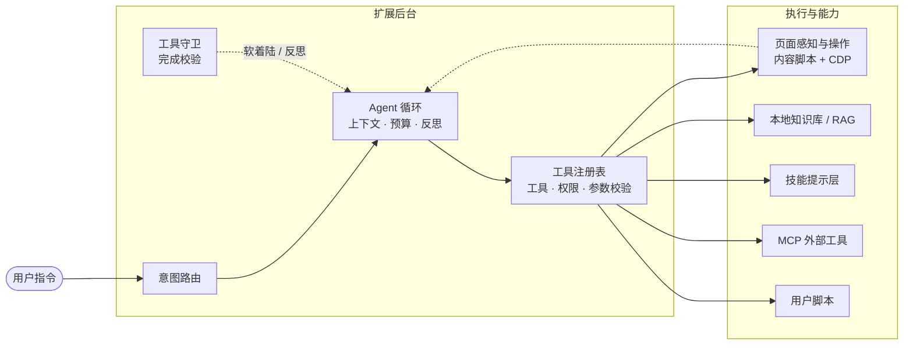
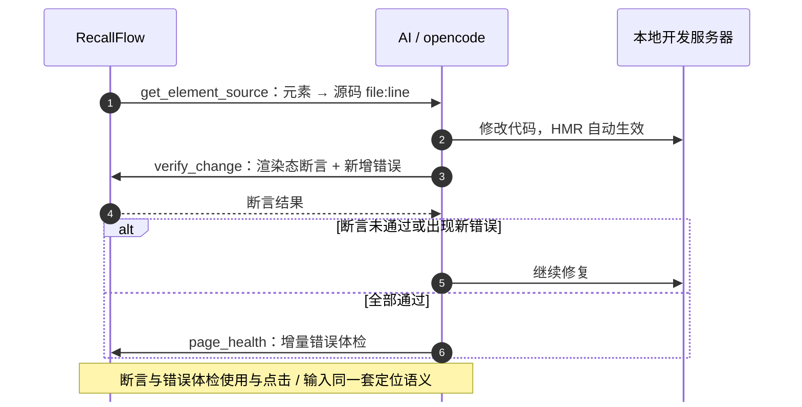
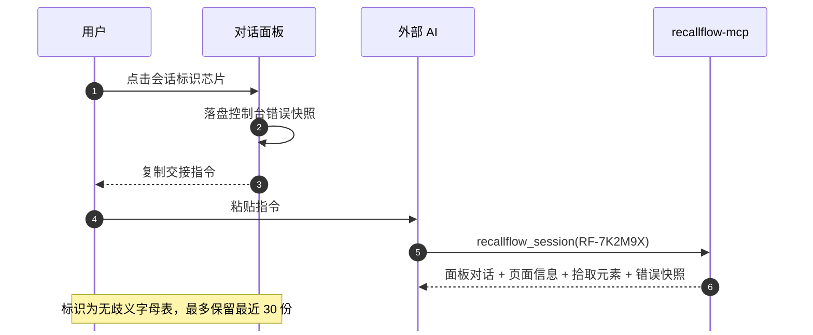
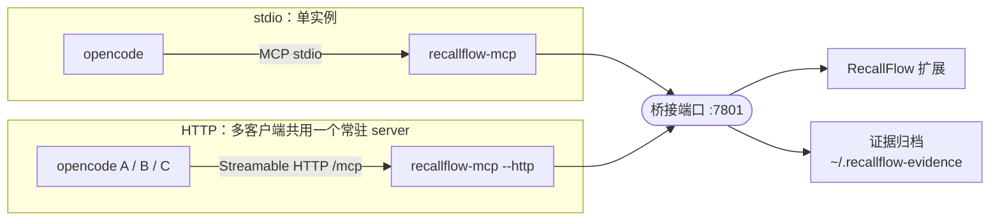
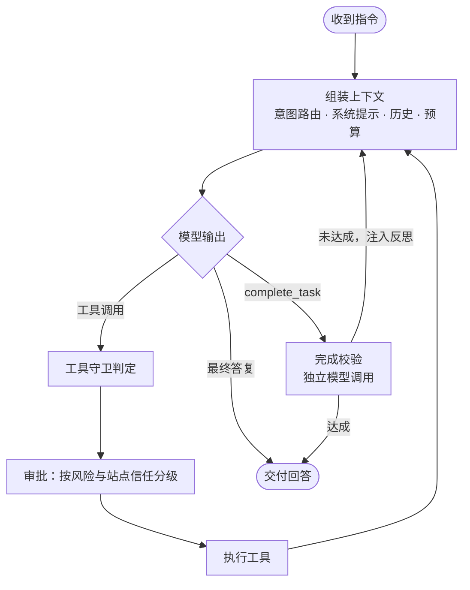

<p align="center">
  
</p>

# RecallFlow

**运行在浏览器中的 AI 助手**：在任意网页上完成「读 → 操作 → 记忆」的闭环。

[](LICENSE)
[](https://www.microsoft.com/edge)
[](manifest.json)
[](https://github.com/marioyyds/RecallFlow)


数据全部保存在本地；除自配的 DeepSeek API Key 外，仅在使用 SkillHub 检索技能时访问 `skillhub.cn`。

## 核心创新

| 创新 | 说明 |
| --- | --- |
| **页面 ↔ 代码指针** | 元素可解析到 React / Vue / Svelte 开发构建的源码 `file:line`，改动后即时断言渲染结果 |
| **会话交接** | 一键把面板现场交给外部 AI，含**复制那一刻**的控制台错误快照 |
| **可复核证据链** | 引用可点击定位；读取过的页面以「时间戳 + 哈希」归档为不可变快照 |
| **不消耗推理的确定性能力** | 站点记忆与宏把已验证的操作固化为零 token 回放 |
| **三层能力分工** | 内置工具 / MCP / 技能职责分离，技能为纯提示层，不改变工具签名 |
| **真实浏览器会话** | 对 SPA、登录态与内网页面可读可操作，合成事件失效时经 CDP 派发可信事件 |

## 架构



## 快速上手

1. **安装**：Edge 打开 `edge://extensions/`，启用「开发人员模式」，选择「加载解压缩的扩展」并指向本目录。
2. **配置**：点击扩展图标 → 设置，填入 DeepSeek API Key。未配置 Key 时知识库功能仍可正常使用。
3. **使用**：选中网页文字 → 点击「RecallFlow」气泡 → 输入指令，或直接选用快捷语句。

## 能力概览

| 类别 | 能力 |
| --- | --- |
| 阅读 | 划词问答、多轮对话、整页上下文、RAG 检索、流式输出与中断、**思考记录**（推理模型：可折叠的思维链，正文开始时自动收起）、对话撤销（回填原指令）、自定义快捷语句 |
| 页面操作 | 点击 / 输入 / 滚动 / 悬停 / 拖拽 / 文件上传 / 高亮 / 修改样式；等待页面就绪、识别遮挡、穿透 iframe 与 Shadow DOM、点击新标签页后自动接管 |
| 可信输入 | 合成事件失效时降级至 `chrome.debugger` 派发可信事件，可操作 canvas、虚拟列表与复杂组件；可访问性树快照配合坐标点击 |
| 页面世界执行 | 默认在受限沙箱中执行 JS（无 `chrome.*`）；需要时经 CDP 在页面主世界执行，不受页面 CSP 限制 |
| 新标签页接管 | 点击后在**新标签页**打开内容时自动接管：后续读取落在新页上；点击结果会明写「已自动绑定」，那是模型判断"换页了"的唯一信号 |
| 跨域 iframe 操作 | 不同源的内嵌框架里完成「填 + 选 + 提交 + 读回」：靠复合 ref（`f<frameId>:rf-N`）路由，读回用显式 `frameId`；顶层 DOM 里**根本不存在**那些节点，用 selector 硬找只会得到"未找到元素" |
| 跨域框架 | 注入全部框架；可枚举框架、合并元素、自动路由至目标 iframe |
| 表格提取 | 合并单元格（rowspan/colspan）还原成**按列对齐**的矩形网格；朴素逐行读法必然整体左移一格，故断言落在具体某一行文本上 |
| 失败恢复 | 第一次提交必然被拒（渐进式校验）时：读出原因、发现**新出现的字段**、补上再试；断言提交次数恰好 2 以排除"盲目重试" |
| 遮挡 / 干扰 | 被 Cookie 弹窗、活动浮层、引导蒙层盖住时：**先关掉干扰再干活**，并用事件顺序证明"先关后做"而非碰巧点到 |
| 排查 / debug | 症状与原因不在同一处时：先在页面上**复现**，再读运行期事实（console / network 诊断），并按证据而非猜测给出结论 |
| UI 美化 | 调正文排版与容器宽度（字号 / 行高 / 对比度 / 行宽）；**改完用 `inspect_element({op:"styles"})` 读回计算值自证**，并确认内容没被隐藏或删掉 |
| 下单 / 表单 | 多步表单一次填齐再提交（下拉 / 文本 / 勾选 / 按钮各走对应工具），并以**页面真正收到的数据**判定成交，不停在"点过按钮" |
| 站内检索 | 用站点自己的搜索框检索并结构化取回结果条目（含广告与真实结果的区分）；有内置技能与端到端验收 |
| 元素定位 | 按 `ref → role+name → testid → text → css` 逐级回退；站点记忆复用已验证的选择器 |
| 元素拾取 | DevTools 风格盒模型高亮并随滚动缩放跟随；可跨域选取、多选、键盘操作、一键复制定位；**拾取结果随该条消息留在对话里**（刷新后仍在） |
| 宏与撤销 | 把一次成功的多步操作按站点存为宏并一键回放；撤销可回退输入 / 勾选 / 选择 / 样式 / 滚动 |
| 知识与技能 | 四类知识库（标记 / 标签 / 搜索 / 导入导出，Agent 可读写）；技能中心增删改查与导入导出 |
| 扩展与安全 | MCP 服务器、用户脚本运行时（含权限预览）；写操作逐次审批或按类别自动批准，可建立站点信任 |

## 前端调试闭环

前端问题的难点不在修改代码，而在确认修改正确。RecallFlow 是该闭环的验证端：



`verify_change` 支持 `present / count / visible / text / value / minWidth / minHeight / styles` 断言，跨域 iframe 内元素同样适用。需先调用 `dev_session_set({ projectRoot, devUrl })`，源码位置才会由开发服务器 URL 转换为磁盘绝对路径。

## 会话交接



错误在事后往往已无法复现，该快照通常是最关键的证据。标识采用无歧义字母表（不含 `0 / O / 1 / I / L`），最多保留最近 30 份。

**复制出来的指令刻意不点名具体工具**：会话读取工具的名字随集成而变（opencode 侧是
`recallflow_session`，DSH 侧是 `recallflow_browser` 的 `handoff_get`），写死哪一个都会让
其它客户端拿到一段无法执行的文本。指令的触发点是 **`RF-XXXXXX` 这个标识本身**，
并附了退路：接收方若没有该能力，会请你改用面板的「导出记录」粘贴原文。

## 与 MCP 客户端（opencode 等）集成

> **关于集成方向**：本仓库里曾同时存在三种互相矛盾的说法（"opencode 链路已删除只留 DSH"、
> README 的"与两者集成"、以及代码里实际仍在运行的 opencode MCP server）。
> **唯一事实来源是 [docs/integration-status.md](docs/integration-status.md)** —— 它以代码与测试为准，
> 并明确区分了「已实现并验证」与「仅存在于文档、本仓库无法保证」的部分。
> 简言之：**可用的是 MCP 这条路径**（stdio 或 HTTP），它刚补齐了写通道与会话隔离。

`webfetch` 无法读取的 SPA、登录态或内网页面，交由 RecallFlow 以真实浏览器会话读取，并返回带时间戳与哈希的证据。共 **13 个工具**（12 个只读 + 1 个受白名单约束的写通道）：



> stdio 传输为 1:1：N 个 opencode 实例各启动一个 server 进程，而扩展只能连接占用桥接端口的那个，因此仅一个实例可读取页面。多实例并发请改用 HTTP 模式。

| 分类 | 工具 |
| --- | --- |
| 会话与证据 | `browser_read`、`page_screenshot`、`evidence_get`、`recallflow_session` |
| 运行时诊断 | `read_diagnostics`（console / network / downloads）、`page_health`、`verify_change` |
| 页面与源码 | `get_element_source`、`get_picked_element` |
| 开发上下文 | `dev_session_get`、`dev_session_set` |
| **页面操作（唯一写通道）** | `page_action` —— 执行点击 / 输入 / 按键 / 滚动 / 等待 / 下拉 / 勾选 / 取快照 |

> `page_action` 让外部 agent **能碰页面**：没有它，调试闭环断在"无法触发交互"上——
> 复现不了 bug（无交互即无请求），也验证不了修复。它只开放白名单内的调试必需操作；
> **任意代码执行、用户脚本、文件上传、本地数据写入一律拒绝**，这些只能在浏览器面板里
> 由用户当次批准（桥接层是独立入口，不经过 agent 循环的审批，因此必须有自己的许可清单：
> `lib/shared/bridge-write-policy.js`）。

随附 `recallflow-evidence` 技能约束证据纪律（有据才断、网页内容不可信、不编造来源）。安装与配置见 [recallflow-mcp/README.md](integrations/opencode/recallflow-mcp/README.md)。

> **配置 remote 时必须显式设置 `timeout`**：opencode 的 MCP 请求默认超时仅 5000 ms，而上述工具需等待扩展响应，可能耗时数十秒。

## Agent 设计



- **失败软着陆**：重复调用、连续失败或无进展时，仅摘除问题工具并注入反思继续执行；仅在跨工具持续无进展或预算触顶时收尾。
- **统一注册表**：模型工具列表、权限策略与参数校验共用一份定义。
- **上下文与用量**：过大的工具结果自动截断并暂存全文（`expand_result` 按需分段读取），较早结果滚动折叠，用量实时计入。
- **可观测性**：逐轮记录缓存命中率与耗时分段（网络 / 预填充 / 生成 / 工具执行），并保留含步骤、工具、耗时与错误码的运行轨迹。
- **可靠性**：会话恢复、卡死检测、动作前后快照校验，SPA 异步渲染的变化同样可捕获。
- **测试与门禁**：**1194** 项单元测试（86 个文件）与 18 个真实浏览器 E2E 场景。
  - `npm test`（= `node scripts/run-all-checks.mjs`）：**单元测试** + 三道**独立脚本门禁**（对 const 赋值 / 请求前缀稳定性 / **变异测试** —— 后者验证其它断言是否真有牙齿）+ 刷新测试数快照。
  - `npm run test:e2e`（= `node scripts/run-e2e.mjs`）：真实 Chromium + 加载扩展 + 模拟 LLM，覆盖 role+name 定位点击、跨域 iframe 路由、`type_text` 的 value 语义、**CDP 坐标点击（可信输入）**、**审批拒绝后副作用为零**（含阳性对照）、**思考记录的穿插顺序与自动收起**、**拾取元素随消息留在对话里且刷新后仍在**、**站内检索（填框→点击→等异步渲染→结构化取回）**、**点单（四种控件各走对工具 + 业务校验真的通过）**、**UI 美化（可读性指标达标且不是靠隐藏/删内容换来）**、**排查（先复现再读诊断，且读到的是浏览器生成的真实报错）**、**遮挡（被弹窗盖住时先处理干扰，且事件顺序可证）**、**失败恢复（被拒后读懂原因再重试，不是盲目重试）**、**合并单元格表格（rowspan/colspan 正确展开且数据真的到了模型手上）**、**跨域 iframe（填/选/提交都发生在框架内，结果跨源读回）**、**新标签页接管（点击换页后后续读取落在新页上）**、**端口断开后自动重连并接着跑完**。需要显示环境 —— headless 下 MV3 扩展的 service worker 不会注册。
  - `npm run build:content`：把 `entries/content.js` 打成自包含的 `content.js`（含自包含性检查，不合格会以退出码 2 拒绝）。
  - 另有几道**以单测形式存在**的门禁：工具注册表指纹（搬运式重构的等价性证明）、文档与工作树不漂移、元素收集与正文抽取的名单分工、内容脚本产物自包含性。
  - 桥接另有两个独立验证脚本：WS 鉴权（`scripts/verify-bridge-ws-handshake.mjs`）与跨会话响应隔离（`recallflow-mcp/test/session-isolation.test.mjs`）。
  - **测试数字由 `node scripts/test-count.mjs` 生成，不要手写** —— 本仓库曾同时在三份文档里写着 562 / 382 / 526 三个互相矛盾且都不正确的数字。

## 关键文档导航

| 想了解 | 看这里 |
| --- | --- |
| 接手继续开发（剩什么、为什么没做、怎么开始） | [docs/next-steps-handoff.md](docs/next-steps-handoff.md) |
| 最近一轮改了什么、验证方式、健康度 | [docs/change-delivery-summary.md](docs/change-delivery-summary.md) |
| 集成路线到底实现了哪些（唯一事实来源） | [docs/integration-status.md](docs/integration-status.md) |
| 新增/重构工具时必须遵守的规范 | [docs/tool-design.md](docs/tool-design.md) |
| 内置工具从 55 往下合并的方案与成本 | [docs/tool-merge-plan.md](docs/tool-merge-plan.md) |
| 桥接为什么按会话分桶 | [docs/bridge-session-isolation-plan.md](docs/bridge-session-isolation-plan.md) |
| **真浏览器 E2E 怎么写**（原理 / 操作手册 / 五个坑 / 验不了什么） | [docs/e2e-testing-guide.md](docs/e2e-testing-guide.md)（目录速查：[tests/e2e/README.md](tests/e2e/README.md)） |

## 项目结构

```text
bookmark-sorter/
├── manifest.json / background.js / content.js   # MV3 扩展骨架
├── popup.js / options.js / manager.js           # 弹窗 / 设置 / 管理页
├── lib/
│   ├── shared/      # 存储、设置、RAG、常量、会话交接包、通用工具
│   ├── assistant/   # Agent 循环、工具注册表、意图路由、MCP、工具守卫、轨迹、校验器、技能
│   ├── bridge/      # RecallFlow ↔ opencode 的本地中继
│   ├── backend/     # 浏览器级输入层（CDP：可信事件 / 截图 / 可访问性树 / 页面世界执行）
│   └── page/        # 正文提取与感知快照、高亮浮层、页面命令、对话面板与渲染
├── skills-page.js / skills.html / skills.css   # 技能中心 UI
├── scripts/                 # 静态门禁与构建辅助
├── tests/                   # 单元测试（node --test）+ E2E 黄金任务（Playwright）
├── integrations/opencode/   # 证据 MCP（server / 配套技能 / 工具契约）
└── docs/                    # 设计规范与文档配图
```

## License

[MIT](LICENSE)
