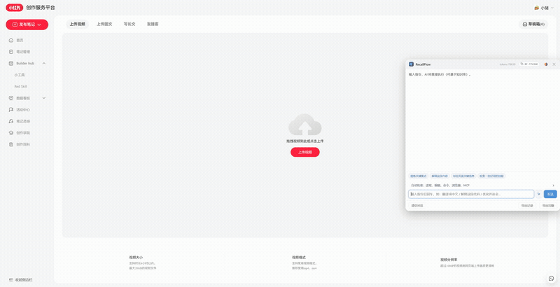
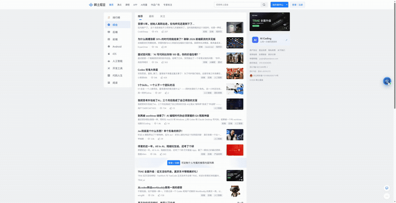
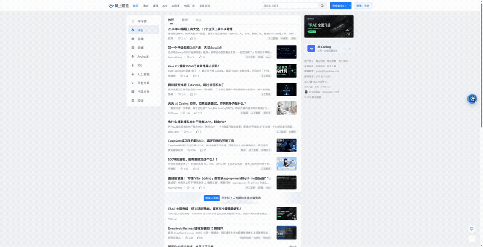
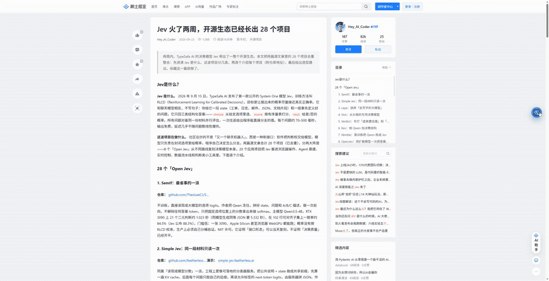
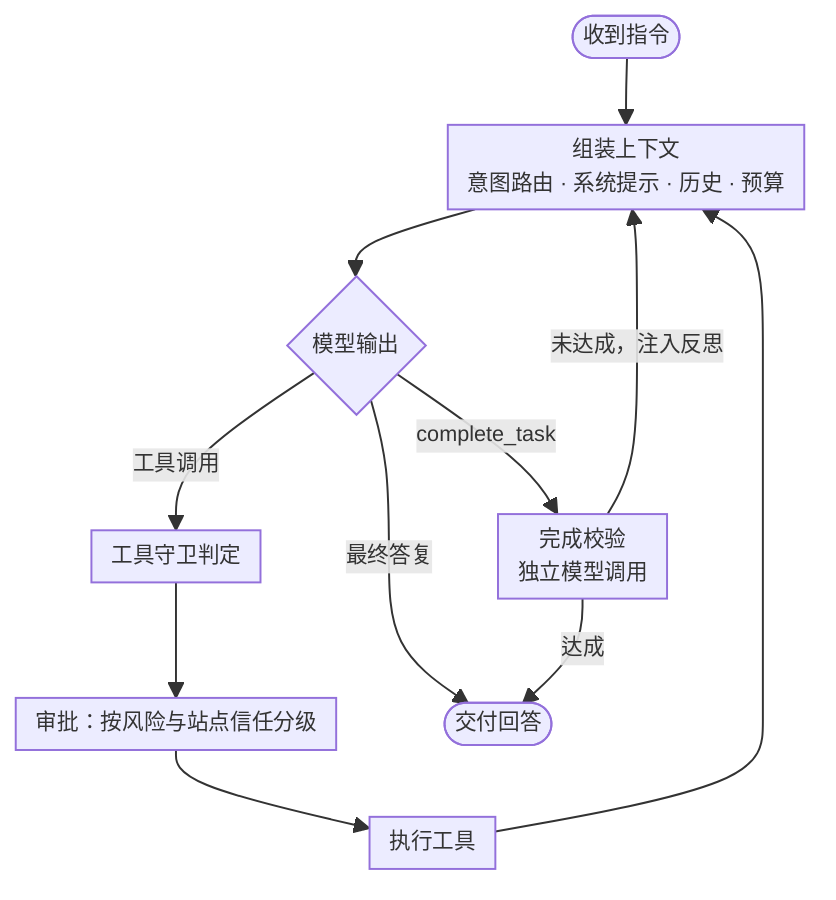

<p align="center">
  
</p>

# RecallFlow

**你的浏览器办公助手**：能操作网页上的**一切元素** —— 读、点、填、拖、上传、翻页、跨页搬运，把重复的网页工作交给它。

[](LICENSE)
[](https://www.microsoft.com/edge)
[](manifest.json)
[](https://github.com/marioyyds/RecallFlow)


## 它是什么

RecallFlow 不是把 HTML 塞给模型，而是**在你的真实浏览器里动手**：登录态、SPA、内网页面都能读能操作；
合成事件失效时经 CDP 派发**可信事件**。它会记、会复用（站点记忆 / 技能 / 宏），
数据全部保存在本地 —— 除自配的 DeepSeek API Key 外，仅在使用 SkillHub 检索技能时访问 `skillhub.cn`。

## 真实执行

在扩展面板里让 Agent（自配 DeepSeek）在真实页面上干活，右栏是面板逐步长出的工具记录。

| 场景 | 录屏 |
| --- | --- |
| 自动发布小红书：打开创作页、填标题与正文、插入图片、添加话题、点击发布 |  |
| 页面操作：在真实页面上完成点击 / 输入 / 提交 |  |
| 当前页面搜索：在页面内检索目标并定位到结果 |  |
| 画出页面重点：高亮 / 标注页面上的关键信息 |  |

> 均为**加速回放**；第三方站点需登录，属真实场景展示，不在自动化测试覆盖范围内。

## 核心能力

目标是**网页上的一切元素**：跨域 iframe、Shadow DOM、canvas、虚拟列表、自定义日期选择器、
上传 / 拖拽 / 级联下拉、分页与无限滚动…… 难点与逐条保证见 **[能力清单](docs/capability-inventory.md)**。

## 快速上手

1. **安装**：Edge 打开 `edge://extensions/`，启用「开发人员模式」→「加载解压缩的扩展」→ 指向本目录。
2. **配置**：点击扩展图标 → 设置，填入 DeepSeek API Key（未配置时知识库仍可正常使用）。
3. **使用**：打开一个页面 → 点右侧「RecallFlow」气泡 → 输入指令，或直接选用快捷语句。
4. **本地网页（可选）**：要让它也能操作你双击打开的本地 HTML，需在 `edge://extensions/` → 本扩展 → 详情 → 打开
   **「允许访问文件网址」**。开启后本地页与普通网页一致（打开就有悬浮球），且保存/打印时不会把扩展图标写进你的文件
   （细节与验收见 [docs/local-page-support.md](docs/local-page-support.md)）。

## Agent 设计



- **失败软着陆**：重复调用、连续失败或无进展时，守卫**只注入反思建议、不摘除工具**（把工具拿走是在替模型做决定）；仅在跨工具持续无进展或预算触顶时收尾。
- **统一注册表**：模型工具列表、权限策略与参数校验共用一份定义。
- **上下文与用量**：过大的工具结果自动截断并暂存全文（`expand_result` 分段取回），较早结果滚动折叠。
- **可观测性**：逐轮记录缓存命中率与耗时分段（网络 / 预填充 / 生成 / 工具执行），保留含步骤、工具、耗时与错误码的运行轨迹。
- **可靠性**：全浏览器共享会话（IndexedDB 持久化 / 新建 / 历史 / 跨标签页流式跟随 / 运行锁）、会话恢复、卡死检测、动作前后快照校验，SPA 异步渲染的变化同样可捕获。

## 与外部 AI 集成（MCP）

`webfetch` 读不到的 SPA、登录态或内网页面，交由 RecallFlow 以真实浏览器会话读取，返回带时间戳与哈希的证据；
外部 agent 还能经唯一写通道 `page_action` 碰页面，形成「读 → 改 → 验」的前端调试闭环。
集成路线的**唯一事实来源**是 [docs/integration-status.md](docs/integration-status.md)，
安装与配置见 [recallflow-mcp/README.md](integrations/opencode/recallflow-mcp/README.md)。

## 文档导航

| 想了解 | 看这里 |
| --- | --- |
| 能力各由什么保证（夹具页 / 剧本 / E2E / 技能 / 判据，自动生成） | [docs/capability-inventory.md](docs/capability-inventory.md) |
| 技能清单（技能 / 剧本归属 / 孤儿 / 薄技能，自动生成） | [docs/skills-overview.md](docs/skills-overview.md) |
| 运行时到底怎么选技能 | [docs/skill-design.md](docs/skill-design.md) |
| 面板会话如何共享、切换与加运行锁 | [docs/panel-sessions.md](docs/panel-sessions.md) |
| 真浏览器 E2E 怎么写 | [docs/e2e-testing-guide.md](docs/e2e-testing-guide.md)（速查：[tests/e2e/README.md](tests/e2e/README.md)） |
| 真模型 eval 怎么跑、历次结果 | [docs/real-model-eval-log.md](docs/real-model-eval-log.md) |
| 集成路线到底实现了哪些（唯一事实来源） | [docs/integration-status.md](docs/integration-status.md) |
| 新增 / 重构工具时必须遵守的规范 | [docs/tool-design.md](docs/tool-design.md) |
| 接手继续开发（剩什么、为什么没做、怎么开始） | [docs/next-steps-handoff.md](docs/next-steps-handoff.md) |
| 最近一轮改了什么、怎么验证的 | [docs/change-delivery-summary.md](docs/change-delivery-summary.md) |
| 本地网页（file://）支持到哪、为什么导出不留痕 | [docs/local-page-support.md](docs/local-page-support.md) |
| 官网怎么发上去、Pages 怎么启用、部署怎么排障 | [docs/github-pages.md](docs/github-pages.md) |

> 官网：<https://marioyyds.github.io/RecallFlow/>（**部署启用后生效** —— 仓库当前尚未开启 Pages，
> 需先在 Settings → Pages → Source 选 GitHub Actions，见 [docs/github-pages.md](docs/github-pages.md)）

> 规模数字（能力剧本 / 技能 / 判据 / 测试数与文件数）一律由脚本生成，见上述清单与
> [`tests/.test-count.json`](tests/.test-count.json)；README 不手写数字 —— 手写的必然腐烂。

## 项目结构

```text
RecallFlow/
├── manifest.json / background.js / content.js   # MV3 扩展骨架（content.js 由 scripts/ 构建）
├── popup.js / options.js / manager.js           # 弹窗 / 设置 / 知识库管理页
├── lib/
│   ├── shared/      # 存储、设置、RAG、常量、会话交接包、通用工具
│   ├── assistant/   # Agent 循环、工具注册表、意图路由、MCP、工具守卫、校验器、技能
│   ├── bridge/      # RecallFlow ↔ 外部 AI 的本地中继
│   ├── backend/     # 浏览器级输入层（CDP：可信事件 / 截图 / 可访问性树 / 页面世界执行）
│   ├── page/        # 正文提取、感知快照、页面命令、对话面板与渲染
│   └── userscript/  # 用户脚本运行时（含权限预览）
├── scripts/                 # 静态门禁、构建辅助、能力清单生成
├── tests/                   # 单元测试（node --test）+ E2E 黄金任务（Playwright）
├── integrations/opencode/   # 证据 MCP（server / 配套技能 / 工具契约）
└── docs/                    # 设计规范与文档配图
```

## License

[MIT](LICENSE)
