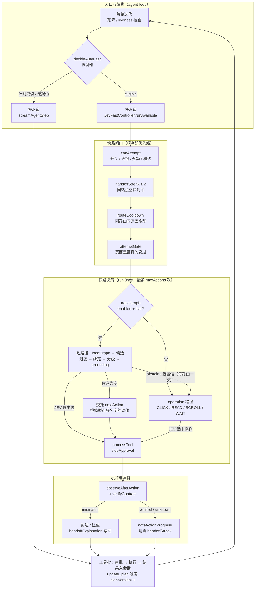
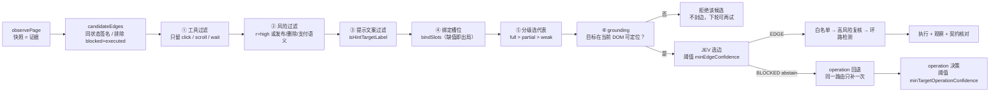

# 快慢思考系统架构（当前实现）

> 一句话：**慢思考决定「做什么」，快思考决定「在哪做、并执行」；谁先动由协调器唯一裁决。**
> 本文是当前代码的事实对照，改实现时先改这里。

## 1. 分层组件图

## 2. 边路径的候选漏斗

漏斗每一段都有 trace 计数（`tracegraph-candidates`：`nominated / filteredSlowTools /
filteredRiskyEdges / filteredHintEdges / filteredUnbound / prunedByFull /
filteredTargetMissing / filteredNoopNavigation / prunedNavigation`），排查时直接看这一段。

## 3. 一轮的时序

```mermaid
sequenceDiagram
  participant L as agent-loop
  participant C as 协调器
  participant J as JevFastController
  participant G as tracegraph
  participant S1 as systemone
  participant P as 页面工具
  participant M as 慢模型

  L->>C: decideAutoFast(plan, eligibility)
  C-->>L: plan-slow-only / plan-no-verify / ready
  alt ready
    L->>J: runAvailable(iter)
    J->>P: observePage（快照）
    J->>G: loadGraph + candidates
    J->>S1: 边决策（带阈值）
    S1-->>J: EDGE / BLOCKED(abstain)
    J->>P: processTool(skipApproval)
    J->>P: observeAfterAction
    J->>J: verifyContract（advisory）
    J-->>L: act / skipped(reason)
  end
  L->>M: streamAgentStep（拿计划与工具调用）
  M-->>L: tool calls
  L->>P: 工具批（含审批）
  P-->>L: 结果写回会话
  Note over L: update_plan → planVersion++ → 租约与计数重置
```

## 4. 闸门与计数

| 闸门 | 判定位置 | 作用 | 默认/取值 |
|---|---|---|---|
| 计划只读 | `coordinator.decideAutoFast` | `allowedOperations: []` 时快路整轮不启动 | 计划字段 |
| 无动作契约 | 同上 | 点击类无 verify 且非只读集合 → 不给快路 | `plan-no-verify` |
| 开关/凭据 | `canAttempt` | enabled、非 CHAT、apiKey/model/baseUrl | 设置 |
| 计划租约 | `canAttempt` | `leaseActions` 用尽即停 | 计划字段 |
| 尝试上限 | `canAttempt` | 每 run 快路尝试次数 | 36 |
| 连续动作 | `canAttempt` | 快路连续执行数 | 12 |
| 连续失败 | `canAttempt` | ≥2 次失败即停 | 2 |
| 工具推进 | `canAttempt` | 上轮之后工具数没涨就不再试 | 防止空转 |
| 站点空转 | `autoFastEligibility` / `runAvailable` | 同 host 连续 2 次无动作 → `handoff-streak` | 2 |
| 路由冷却 | 同上 | 同 url+fingerprint 同原因的失败在冷却内不再试 | 见 `ROUTE_COOLDOWN_REASONS` |
| 页面变化 | `attemptGateReason` | 上次让位后只做了只读工具 → `no-page-change` | — |
| 动作环路 | `wouldCycle` / `noteActionProgress` | 最近动作序列回环、同签名无进展 | 2 次 |

## 5. 让位原因与用户可见解释

`handoffExplanation` 负责把 trace 里的原因翻译成人话（面板与诊断日志都引用它）：

| reason | 含义 |
|---|---|
| `edge-no-candidates` | 该状态下没有可复用的边 |
| `edge-target-missing` | 目标元素当前不在快照里 |
| `edge-abstain` / `edge-low-confidence` | 模型没把握，主动让位 |
| `edge-hint-label` | 命中的是提示/前置条件文案，不是可点按钮 |
| `edge-high-risk` | 发布/删除/支付类动作，必须慢思考确认 |
| `duplicate-read` | 同一页刚读过，再读没有新信息 |
| `action-mismatch` | 动作执行了，但契约核对不通过 |
| `no-page-change` | 页面没变，再试只会付一次 observe + systemone |
| `handoff-streak` | 本站点已经连续空转 2 次 |

## 6. 动作契约（verify）

| 契约 | 通过条件 |
|---|---|
| `urlChanged` | URL 变化 |
| `fingerprintChanged` | 页面指纹变化（点击类默认） |
| `minElementDelta` | 元素数变化 ≥ N |
| `textIncludes` | 页面文本包含目标串 |

校验失败的处理是**劝告式**的：记为 `verify` 警告，不撤回动作、不阻断
`complete_task`；快路的 `mismatch` 才会封边/让位（因为那是快路自己的动作）。

## 7. 已知边界

- 快路不判断「任务是否完成」：`DONE` 只作让位信号，收尾永远由慢思考 + verifier 决定。
- 快路不做跨页战略：`open_tab` / `switch_tab` 仅接受慢模型显式委托，且受导航预算约束。
- 快路不生成字段值：`TYPE_TEXT` 不在 operation 空间，写入只来自慢思考回合或计划槽位。
- 阈值是 JEV 自报置信度的**后置过滤**，不是授权；提高阈值只会更少动作，不会更准。
- 组织/统计口径：`tracegraph-metrics` 与 `jev-decision` 是唯一可信计数来源。