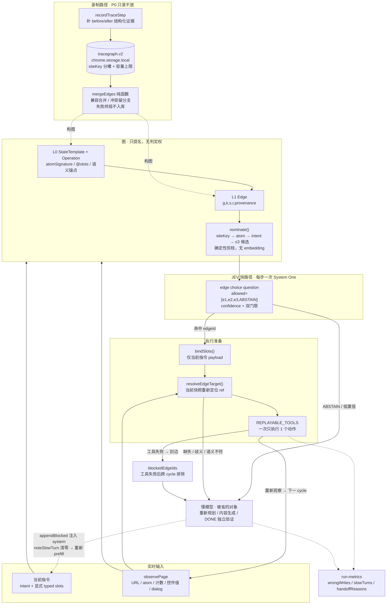

# tracegraph.v2 设计方案 · 证据约束的选择性轨迹复用

> 面向执行 Agent 的工程规格。与 `执行Agent_任务Prompt.md`、`tracegraph.v2.schema.json` 配套使用。
> 口径已按「省的是慢思考调用，不是 JEV 请求」修正；所有结论基于一次真实 RecallFlow PR 创建轨迹 + 三版离线 MVP 验证。

---

## 0. 现状与目标

### 0.1 现状（代码事实）

| 位置 | 事实 |
|---|---|
| `tools.ts` `recordTraceStep` | 只留 `{tool, args}`，前后状态证据全丢 |
| `macro-store.sanitizeSteps` | 落库时再砍一次字段 |
| `macros.ts` `macroRun` | 一个 `for` 循环，`ok:false` 才停；无分支、无证据、失败不回慢模型 |
| `settings.ts` | `enabled:false` / `shadowMode:true`（默认未开） |
| `jev-controller.ts` shadow 分支 | 跑一次即 `return {kind:'shadow'}`，**零动作**；`jevLoop` 立即退出 |
| `jev-controller.ts` | 8 类 handoff：`done-claim` / `blocked` / `observation-failed` / `request-failed` / `text-helper-failed` / `repeated-action` / `wait-limit` / 连续两次工具失败 / `maxConsecutiveActions` / `planVersion` 重置 |
| `jev-controller.ts` `appendBlocked` | 向 `messages` push 一条 system → 慢模型**重新 prefill** |
| `agent-loop.ts` `noteSlowTurn()` | 清零 `consecutiveFastActions` → 整段快路径被打断 |
| `run-metrics.ts` | `jevShadowAgreed` 只是一致率统计，不产生收益 |
| `verifyPageAction` | 判 `changed / alreadySatisfied`，不是「期望值成立」 |
| `deriveJevPhase` | URL/title 正则分四类；`fingerprint` 是整页结构 hash |

**真实轨迹基线**：一次 PR 创建，20 次工具调用 / **19 次慢思考**，其中 17 步机械性、4 步真不可省。这就是「现阶段 JEV 省不了慢思考」的实测。

### 0.2 目标

```
图存证据、只提名；JEV 逐步选边/弃权；当前快照 Grounding 后直接执行；
慢模型接住 JEV 弃权、参数缺失或目标无法重定位的情况
```

- **省下的是慢思考调用**（LLM prefill + generation + 工具结果回灌），不是 JEV 请求。
- **JEV 每步仍付一次 `/v1/systemone`**。
- 慢思考降不到 0：内容生成 + DONE 独立验证不可省，每任务保留 1–2 次。
- live edge 路径不运行 R3、φ⁻、逐次审批或 φ⁺ 验证；选中 edge 后只做当前指令
  slot 绑定、当前快照语义目标 Grounding、直接执行和重新观察。

### 0.3 非目标（明确不做）

❌ embedding / 向量库 / 截图编码　❌ O(1) 一次性合成完整程序、整脚本回放　❌ Crawling Agent 主动全量爬取　❌ 把置信度当执行授权　❌ live edge 逐次审批　❌ live edge 后置 φ⁺ 验证　❌ 静默填历史值

---

## 1. 架构

### 1.1 分层理由

| 层 | 借自 | 存什么 | 任务相关性 |
|---|---|---|---|
| **L0 应用模型** | ActionEngine / State Machine Memory | 界面模板、atom 组合、operation 契约、语义锚点 | **任务无关**，跨任务复用 |
| **L1 证据边** | 历史 R3 论文 + RecallFlow 实测 | 状态转移、语义目标、slot 契约、风险与 provenance | **带任务上下文的已验证实例** |

合成一张会两头不讨好：要么被任务值污染，要么被模板抽象抹掉证据。

### 1.2 全景图



纯文本兜底：

```
当前指令 + observePage
      │
      ▼
[L0 atom + L1 证据边] → nominate() → ≤3 候选边（只提名）
      │
      ▼
[JEV] edgeId | ABSTAIN（选定执行边或弃权）
      │ 命中                    └─ 低置信 ───────┐
      ▼                                          │
[执行准备]                                       │
  bindSlots → resolveEdgeTarget → 执行 1 动作    │
      │ 目标唯一、工具成功                       │
      ▼                       │ 工具失败         │
  observePage → 下一步         └→ blockedEdgeIds ─┤
                                                 ▼
                              慢模型接管（★ 省的是它）
                              appendBlocked → 重新 prefill
                              noteSlowTurn → 整段 cooldown
```

### 1.3 单步时序（一个 cycle）

```
1. observePage → atomSignature(state) + 结构化证据（URL / 计数 / 控件值 / dialog）
2. nominate() → 2~3 条候选边；criteria = g + slot 摘要 + risk + 当前目标可见性
3. JEV 一次请求 → edgeId 或 ABSTAIN（confidence 过门限）
4. bindSlots()：payload 只来自当前指令
5. resolveEdgeTarget()：在当前快照按 role/name/text 重新定位，并使用当前 ref
   ├ 唯一匹配 → 执行恰好 1 个动作
   └ 缺失 / 歧义 / 隐藏 / 禁用 / 语义不符 → 慢模型
6. observePage()：为下一 cycle 更新共享页面状态
7. 终局：慢思考独立验证；校验不可用则不得 complete_task

> live edge controller 不再执行 R3、φ⁻、逐次工具审批或 φ⁺ 验证。`decideR3` /
> `evaluatePhiMinus` / `verifyEdgePostcondition` 仅保留为离线回放和诊断函数。
```

### 1.4 两种弃权分开算钱

| 来源 | 触发 | 代价 |
|---|---|---|
| **JEV ABSTAIN / 低置信** | JEV 显式选择 `ABSTAIN`，或所选 edge 的 `confidence` 未过门限 | 交回慢模型，**不产生动作** |
| **执行准备失败** | 槽位未绑定 / 目标缺失、歧义或语义不符 / 工具失败 | `appendBlocked` push system → 慢模型**重新 prefill** + `noteSlowTurn()` 清零 + cooldown |

**压低弃权率两手**：图先确定性剪到 ≤3，降低歧义与上下文噪声（压第一种）；证据契约质量够高（压第二种）。真实轨迹 MVP 中「放开候选上限」handoff 7→26、复用边 82→26。

---

## 2. 数据模型（`tracegraph.v2.schema.json` 为机器可读权威）

### 2.1 顶层

```ts
interface TraceGraphV2 {
  version: 2;
  siteKey: string;              // siteKeyOf(url)，分槽键
  updatedAt: number;
  ttlMs: number;                // 兼容字段；不再作为读取或 live 提名门槛
  l0: { states: StateTemplate[]; operations: Operation[] };
  l1: { edges: Edge[] };
  records: TraceRecord[];       // 原始证据，脱敏 + 按容量上限裁剪
  patchLog: PatchEntry[];       // Patcher 回写审计
}
```

### 2.2 L0

```ts
interface StateTemplate {
  id: string;
  name: string;                 // "PRFormPage"
  urlPattern: string;           // "/pull/compare"
  staticAtoms: string[];        // 恒在结构，排序后参与签名
  dynamicAtoms: string[];       // 只存类型名，不存值/实例数
  fingerprint?: string;         // 仅审计留档，★ 不进节点键
}

interface Operation {
  id: string;
  name: string;
  description: string;          // 含 behaviorNotes：界面看不出、跑一次才知道的行为
  srcState: string; dstState: string;
  inputSlots: string[];         // ["@qty", "@item"]
  outputSchema?: Record<string, unknown>;
  semanticAnchor: { role?: string; name?: string; text?: string };
  selectorHint?: string;        // 可漂移，Patcher 可回写
  waitMs?: number;              // 可回写
  patchable: boolean;
}
```

**atomSignature 规则**（核心防爆炸）：

```
atomSignature(state) = [state.name, sort(staticAtoms).join('+'), sort(dynamicAtoms).join('+')].join('#')
```

禁止进键：控件值、列表实例数、selector / ref、瞬时弹窗、整页 fingerprint、坐标、截图 embedding。
MVP 实测：60 个页面实例 + 3 次 selector 改版 → L0 状态数恒为 **1**；把 dynamic 值 / 实例数 / selector 任一漏进键 → 5 / 9 / 3；整页 fingerprint → **60**。

真实轨迹抽出的 3 个模板：

| 状态 | URL pattern | static | dynamic |
|---|---|---|---|
| `BranchComparePage` | `/pull/new` | BranchSelectors, NextButton, RepoNav, GlobalHeader | CommitPreview |
| `PRFormPage` | `/pull/compare` | TitleInput, DescriptionEditor, OptionsCheckboxes, CreateButton, CancelButton, CommitTabs, MarkdownToolbar, AssigneePopovers | CommitList, TitleValue, DescriptionLength |
| `PRDetailPage` | `/pull/1` | PRTitle, PRStatus, Tabs, MarkdownBody | CommitList, FileDiffList |

### 2.3 L1 证据边

```ts
interface Edge {
  id: string;                   // 稳定 hash，包含真实目标，不含 PlanCard 文案
  identityVersion?: 2;          // 旧身份迁移标记
  from: string; to: string;     // StateTemplate.name | "done"
  g: string;                    // 工具 + 真实目标摘要；不包含 planStep.text
  planVersion?: number;
  successPredicate?: string;
  action: {
    tool: string;
    argsTemplate: Record<string, unknown>;  // 含 slot 占位符，不含具体值
    risk: 'low' | 'medium' | 'high';
  };
  slots: SlotSpec[];
  s: { selector?: string; semanticAnchor: Operation['semanticAnchor'] & { urlPattern?: string } };
  r: 'low' | 'medium' | 'high';
  phiMinus: PhiRule[];          // 历史证据；live 不读取
  phiPlus: PhiRule;             // 历史证据；live 不读取
  semanticSplit?: { slowOnly: string[]; replayable: string[] };
  provenance: { recordIds: string[]; verifiedAt: number; siteKey: string; ttlMs: number };
  status: 'verified' | 'blocked' | 'superseded';
}

interface SlotSpec {
  name: string;
  type: 'string' | 'markdown' | 'number' | 'enum' | 'branch' | 'target';
  source: 'current_instruction';   // ★ 唯一合法来源
  constraint?: string;
  highRisk: boolean;               // 高风险值要求更强证据或强制回退
  // ★ 禁止 recordedValue / defaultValue / 历史偏好
}

type PhiKind =
  | 'url_pattern' | 'counter' | 'value_equals' | 'element_present'
  | 'element_visible' | 'no_dialog' | 'not_satisfied'
  | 'text_contains' | 'diff_exists';

interface PhiRule {
  kind: PhiKind;                  // ★ 白名单；禁止 changed / innerText / screenshot / visible_text
  expr: string;                   // 可求值表达式或声明式断言
  observed?: string;              // 仅录制时样例，不作为判定依据
  source: 'structured';
}
```

**`e5.write-desc` 实例**（来自真实轨迹）：

```json
{
  "id": "e5.write-desc",
  "from": "PRFormPage", "to": "PRFormPage",
  "g": "创建成本域 PR",
  "action": { "tool": "type_text", "argsTemplate": { "ref": "@descriptionEditor", "clearFirst": true, "value": "@description" }, "risk": "medium" },
  "slots": [{ "name": "description", "type": "markdown", "source": "current_instruction", "highRisk": false }],
  "s": { "selector": "div.cm-content:nth-of-type(1)", "semanticAnchor": { "role": "textbox", "name": "输入描述" } },
  "r": "medium",
  "phiMinus": [
    { "kind": "element_present", "expr": "DescriptionEditor is contenteditable", "source": "structured" },
    { "kind": "no_dialog", "expr": "dialog == null", "source": "structured" },
    { "kind": "not_satisfied", "expr": "descCount != len(description)", "source": "structured" }
  ],
  "phiPlus": { "kind": "counter", "expr": "descCount == len(description)", "observed": "2078/65535", "source": "structured" },
  "semanticSplit": {
    "slowOnly": ["生成 2078 字 Markdown 文案"],
    "replayable": ["写入编辑器"]
  },
  "provenance": { "recordIds": ["seq13"], "verifiedAt": 1762690000000, "siteKey": "gitcode.com", "ttlMs": 1800000 },
  "status": "verified"
}
```

> `phiMinus` / `phiPlus` 保留用于历史回放与诊断，帮助解释旧轨迹为何成立；live
> edge controller 不把它们作为执行前许可或执行后完成判定。当前判定权在 JEV：
> 选择 edge 或 ABSTAIN，执行后重新观察，下一 cycle 再由 JEV 决定。

### 2.4 录制证据

```ts
interface TraceRecord {
  id: string; seq: number;
  tool: string; argsRedacted: Record<string, unknown>;   // 值脱敏
  before: Evidence; after: Evidence;
  target?: { role?: string; name?: string; text?: string; selector?: string; urlPattern?: string };
  result: { ok: boolean; summary: string };
  planStep?: string; planVersion?: number; successPredicate?: string;
  verification?: string; risk?: string;
  ts: number;
}

interface Evidence {
  url: string; urlPattern: string; title: string;
  atomSignature: string;
  counters: Record<string, number>;        // {"description": 2078, "title": 54}
  controls: Array<{ role: string; name: string; valuePresent?: boolean; checked?: boolean; expanded?: boolean }>;
  dialog: string | null;
  fingerprint?: string;                    // 仅审计
}
```

### 2.5 明确不存

控件值、列表实例数、selector / ref、瞬时弹窗、整页 fingerprint、控件坐标、截图 embedding、历史偏好默认值、用户隐私明文。`Edge` 中不得出现任何 `recordedValue`。

---

## 3. 真实轨迹的 8 条边（回归基准）

| 边 | 转移 | slots | 历史证据摘要 | risk |
|---|---|---|---|---|
| `e1.confirm-branches` | Compare→Compare | srcBranch, dstBranch | `text_contains` 同时含两值 | low |
| `e2.next` | Compare→Form | — | `url_pattern=/pull/compare` + TitleInput 出现 | low |
| `e3.read-title` | Form→Form | title | `value_equals` 非空 | low |
| `e4.write-title` | Form→Form | **title** | `value_equals` 回读 + `counter=54/200` | medium |
| `e5.write-desc` | Form→Form | **description** | `counter=2078/65535` | medium |
| `e6.read-commits` | Form→Form | — | `text_contains` 提交列表 | low |
| `e7.click-create` | Form→Detail | title, description, srcBranch, dstBranch | `url_pattern=/pull/<n>` + PR 标题相等 | **high** |
| `e8.verify` | Detail→done | — | 已开启 + `#n` + 从 src 合入 dst | high |

`e5` 与 `e8` 标记 `semanticSplit`：内容生成与终局验证不可省慢思考，其余部分可复用。

---

## 4. 纯函数 API（`trace-graph.ts`）

```ts
// L0
export function extractAtoms(snapshot: PageSnapshot): {
  staticAtoms: string[]; dynamicAtoms: string[]; stateName: string;
  counters: Record<string, number>; dialog: string | null;
};
export function atomSignature(state: Pick<StateTemplate,'name'|'staticAtoms'|'dynamicAtoms'>): string;

// 构图
export function mergeEdges(records: TraceRecord[], prev?: TraceGraphV2): {
  l0: TraceGraphV2['l0']; l1: TraceGraphV2['l1'];
};
// 纪律：planStep 不进入边身份；selector/target 区分不同动作；
// 同一目标重复执行合并 provenance；旧身份边从 records 重建。

// 提名（确定性，无 embedding）
export function nominate(graph: TraceGraphV2, ctx: {
  siteKey: string; atomSignature: string; intent: string;
  blockedEdgeIds: Set<string>; executedEdges: Set<string>;
}): Edge[];   // 硬上限 3

// live 执行准备
export function groundEdgeAction(
  edge: Edge,
  observation: Evidence,
  bound: Record<string, unknown>
): {
  ok: boolean;
  args?: Record<string, unknown>;
  reason?: string;
  candidates: number;
  target?: { role?: string; name?: string; basis?: string };
};  // 只接受当前快照中的唯一语义目标，并生成当前 ref
export function bindSlots(edge: Edge, instruction: { slots: Record<string, unknown> }): {
  ok: boolean; bound: Record<string, unknown>; missing: string[];
};  // 值只来自当前指令；不得回填历史值

// 离线回放 / 诊断；live edge controller 不调用以下三个函数
export function evaluatePhiMinus(rules: PhiRule[], obs: Evidence): { ok: boolean; failed: string[] };
export function decideR3(edge: Edge, bound: Record<string, unknown>): 'REUSE' | 'REWRITE' | 'REJECT';
export function verifyEdgePostcondition(
  edge: Edge, before: Evidence, after: Evidence, bound: Record<string, unknown>
): { ok: boolean; reason: string };
export function patchGuard(patch: Record<string, unknown>): {
  ok: boolean; rejectedFields: string[];
};  // 白名单：locator(role/name), waitMs, behaviorNotes；拒绝任务值/槽位默认值/复合操作
```

**live 只有一条控制链**：`nominate → JEV → bindSlots → groundEdgeAction → 执行 →
observePage`。`decideR3`、`evaluatePhiMinus`、`verifyEdgePostcondition` 是离线函数，
用于历史回放和回归诊断，不进入 live edge 路径。

---

## 5. JEV edge question 协议

```ts
{
  type: 'choice',
  key: 'edge',
  question: '哪条历史证据边适用于当前状态与指令？',
  allowed: ['e1', 'e2', 'e3', 'ABSTAIN'],   // ≤3 候选 + 弃权项
  criteria: [
    '候选边的 g 与当前 intent 对齐',
    '候选边描述的目标在当前快照中可观测',
    'slots 能由当前指令显式绑定（未解析指代应弃权）',
    'risk 在 REPLAYABLE_TOOLS 白名单内'
  ],
  choice: 'e2',
  confidence: 0.86
}
```

- 复用 `jev-contract.ts` 的 choice 契约校验与 `addChoice` 的 `minConfidence / minBranchConfidence` 双门限。
- `interpretJevFastDecision` 把 choice 解析成 `edgeId`（**不是 `toolName`**）；`ABSTAIN` 或低于门限 → 直接 handoff，**不产生任何 GUI 动作**。
- edge 路径只使用一个显式 `minEdgeConfidence` 配置，默认 `0.80`；设置页不再暴露
  `minReadConfidence / minActionConfidence / minClickConfidence /
  minWaitConfidence / minTargetOperationConfidence`。这些旧值只保留给未启用
  TraceGraph 的兼容 operation 路径。
- ⚠️ **置信度只决定 edge 选择或弃权**。执行前仍必须通过当前 slot 绑定、目标
  Grounding 和工具白名单；置信度高不能跳过目标重定位。
- ⚠️ choice 直接返回选中项与自身 `confidence`，不再返回概率分布，也不再依赖“最大概率项”或“概率和为 1”。候选仍硬上限为 3，用于控制歧义、上下文成本与延迟；`minEdgeConfidence` 应继续按 edge head 的 live 样本校准。

---

## 6. 逐文件改动清单

| # | 文件 | 改动 | 阶段 | 触碰执行路径 |
|---|---|---|---|---|
| 1 | `lib/application/page/page-text.ts` + `lib/application/agent/types.ts` | `extractAtoms()`；把计数型证据（`2078/65535`）纳入 snapshot `capabilities` / `Evidence.counters` | P0 | 否（只增字段） |
| 2 | `lib/application/agent/tools.ts` `recordTraceStep` | 补 before/after 结构化证据、`planStep / planVersion / successPredicate / verification / risk`；写 `tracegraph.v2` | P0 | 否 |
| 3 | **新增** `trace-graph.ts` | 第 4 节全部纯函数 | P1 | 否 |
| 4 | **新增** `tracegraph-store.ts` | `chrome.storage.local` 读写、siteKey 分槽、容量上限、删除、脱敏、schema 校验 | P0 | 否 |
| 5 | `lib/application/agent/jev-action-space.ts` | 新增 `edge` choice question；`buildJevFastRequest` 塞候选边摘要；operation head 保持原有，**不要加 R3 标签** | P2 | 是（最小） |
| 6 | `lib/application/agent/jev-contract.ts` / 决策解析 | choice → `edgeId`；`ABSTAIN` 路径 | P2 | 是 |
| 7 | `lib/application/agent/jev-controller.ts` | 新增 `blockedEdgeIds`（跨 cycle）、`executedEdges`、`slowTurns / handoffReasons`；接入 `nominate → JEV → bindSlots → Grounding → 执行 → 重新观察`；终局验证步不得被 cooldown 吞掉 | P3 | 是 |
| 8 | `lib/application/agent/page-action-verify.ts` | `verifyEdgePostcondition()` 仅保留为离线回放 / 诊断出口，不再进入 live edge | P3 | 否 |
| 9 | `lib/application/agent/run-metrics.ts` + `types.ts` | 新增 `slowTurns / handoffReasons / candidateCount / jevCalls / blockedEdgeHits`；历史 R3/φ 指标仅兼容离线报告 | P3 | 否 |
| 10 | `lib/application/agent/agent-loop.ts` | DONE 独立校验失败时不得 `complete_task`；`appendBlocked` 的重新 prefill 计入成本 | P3 | 是 |
| 11 | **新增** `patcher-guard.ts` | 回写白名单 + 审计 `patchLog` | P4 | 否 |
| 12 | `macros.ts` | `op=run` 切到新引擎；保留 `REPLAYABLE_TOOLS` 执行期白名单与 `op=save` 写审批 | P4 | 是 |
| 13 | `scripts/eval-jev-real.mjs` | 扩展 `--head=edge --grid`，产出新阈值与样本量说明 | P2 | 否 |
| 14 | `docs/` | 新增本设计文档落地版；更新 `jev-threshold-calibration.md` 注明 edge 分布不可沿用旧值 | P2 | 否 |

**行号以实际代码为准**（分支可能漂移）。已知参照：`settings.ts` 默认开关、`jev-controller.ts` shadow / `appendBlocked` / `noteSlowTurn` / `observePage`（每 cycle 两次）、`agent-loop.ts` `jevFast.noteSlowTurn()`、`run-metrics.ts` `jevHandoffs / jevShadowAgreed`、`jev-action-space.ts` `deriveJevPhase / buildJevFastRequest / choiceAnswer / RISKY_CLICK_LABEL`、`plan-contract.ts` `successPredicate / allowedOperations / leaseActions`、`page-text.ts` `fingerprintElements / hashSnapshot`、`macros.ts` `REPLAYABLE_TOOLS / macroRun`。

---

## 7. 安全边界

- 图是 `chrome.storage.local` 的持久化 JSON，**视为不可信输入**。`macros.ts` 文件头记着真实提权先例：往 storage 塞 `{tool:'run_javascript'}` 可绕过审批。Patcher 拥有图读写权，形状与之同构。
- 每条边执行前必须过：`REPLAYABLE_TOOLS` → `validateToolCall` → 当前 slot 绑定 →
  当前快照 Grounding → `ToolCallPipeline`。edge 快路径跳过逐次审批，因为执行
  决策已经完全交给 JEV；工具白名单、参数 schema 与站点硬阻止仍然保留。
- `patchGuard` 白名单：`semanticAnchor(role/name)`、`waitMs`、`behaviorNotes`。拒绝：任务值、槽位默认值、复合操作、`run_javascript`、任何新增 tool。
- 存储：按 `siteKeyOf` 分槽 + 容量上限；TTL 字段仅兼容旧数据，不再让图失效；
  登录页 / 内网页 / 支付页排除；`argsRedacted` 脱敏；`records` 可按容量裁剪。
- 高风险槽位（金额 / 数量 / 收件人 / 日期）要求更强证据或强制回退；「我常点的那款」这类未解析指代一律 REJECT。

---

## 8. 测试矩阵

### 8.1 13 个真实派生样例（全部替换真实轨迹字段，不凭空造）

| # | 样例 | 期望 |
|---|---|---|
| ① | 完全一致 | JEV 选边 → 当前 ref Grounding → 执行 |
| ② | 换标题 | 当前指令绑定 `@title` 后执行 |
| ③ | 换描述（2078→1200） | 当前指令绑定 `@description` 后执行 |
| ④ | 换源分支 `feat/cost-page-v2` | 当前指令绑定 `@srcBranch` 后执行 |
| ⑤ | 换目标分支 `release/1.2` | 当前指令绑定 `@dstBranch` 后执行 |
| ⑥ | 无可合入差异 | 由 JEV 基于当前 observation 判断选边或弃权 |
| ⑦ | 创建按钮被遮挡（真实 seq18） | Grounding 找不到可用唯一目标 → 慢模型 |
| ⑧ | ref 失效 + selector 改版（真实 seq17/18） | 当前快照按语义目标重新定位 |
| ⑨ | 描述写入后计数未变（真实 seq14 矛盾） | 不运行 φ⁺；重新观察后由下一 cycle JEV 决定 |
| ⑩ | 点创建后 URL 未变（真实 seq15） | 不运行 φ⁺；重新观察后由下一 cycle JEV 决定 |
| ⑪ | 「按上次的 PR 标题」 | 槽位无法从当前指令显式绑定 → 慢模型 |
| ⑫ | PR #1 已存在 | 由 JEV 基于当前 observation 判断选边或弃权 |
| ⑬ | 终局独立校验不可用（真实末行） | DONE 不宣称完成 |

### 8.2 6 个注入缺陷必红

| 缺陷 | 期望变红指标 |
|---|---|
| 绕过当前 slot 绑定 | 任务值缺失或沿用历史值，错误样例必红 |
| 绕过当前语义目标 Grounding | ref 失效或同名多目标场景必红 |
| 允许静默填历史值 | 错写 0→1（样例⑪） |
| selector 进 atomSignature | handoff 上升、复用边下降（样例⑧） |
| `blockedEdgeIds` 不持久化 | 错写 0→1（样例⑨错误传播） |
| 放开候选上限 | handoff 7→26、复用边 82→26（全部样例） |

### 8.3 三档对照基线（离线 MVP 已跑，仅作机制参照，**不是实测收益**）

| 档位 | 慢思考 | handoff | 错误写操作 | 复用边 | 终局 |
|---|---|---|---|---|---|
| 纯慢思考 | 104 | 0 | 0 | 0 | 13/13 |
| 现状 JEV | 52 | 13 | **5** | 0 | **13/13** |
| 历史 R3 离线实验 | **36** | **7** | **0** | **82** | 13/13 |

> ★ **三档终局都是 13/13，但现状 JEV 中间有 5 次错误写操作**（被慢模型后续改回）。所以主指标必须是「即时记账的错写数」，不是任务成功率。指标优先级：`错写数 → 慢思考轮次 → handoff 次数 → 端到端耗时`。

### 8.4 其他门禁

- `node --test tests/tracegraph/*.test.mjs`（纯函数 + schema 校验）
- `scripts/eval-jev-real.mjs --head=edge --grid`（阈值重扫，报告样本量）
- 仓库既有注册表指纹门禁与三层 E2E 必须全绿
- live A/B：纯慢思考 / JEV + edge live，同批任务、同 backbone、同快照策略

---

## 9. 阶段与 go / no-go

| 阶段 | 交付 | 通过条件 |
|---|---|---|
| **P0** | 录制字段 + `tracegraph.v2` store + `extractAtoms` | schema 校验通过；执行路径指纹门禁不变 |
| **P1** | `trace-graph.ts` 纯函数 + 构图 | 13 样例 / 6 缺陷单测全绿 |
| **P2** | edge question + shadow 前置门禁 + **阈值重扫** | 新阈值有样本量说明；shadow 只报安全性不报收益 |
| **P3** | live 灰度：JEV 选边 / Grounding / blockedEdges / 重新观察 / 新指标 | 判据 1–5 全部通过 |
| **P4** | Patcher 回写 + `macro(op=run)` 切换 | 回写不污染任务值；执行期白名单与写审批保留 |

**六个 go / no-go 判据**：

1. 先量真实基线：`rounds / prefillMs / decodeMs / jevHandoffs` 的「每任务慢思考轮次 ↔ handoff ↔ 错写」对应关系。**没有基线不得报收益**。
2. REJECT 率稳定 < 0.5（≥0.75 时现状 JEV 负收益，因 handoff 重新 prefill + cooldown）。
3. 慢思考轮次相对纯慢思考基线下降 ≥50%，但不得降到 0（保留 DONE + 内容生成）。
4. 错误写操作数 = 0（即时记账口径）。
5. 6 个注入缺陷必红。
6. 修图期 / 冻结评测期分离：warm-up 允许 Patcher 修通用知识，评测禁用；失败按 `ambiguous intent / search-dependent / selector-drift` 分类。

---

## 10. 风险与边界

| 风险 | 缓解 |
|---|---|
| 加速收益不确定（取决于慢思考实际耗时与 handoff cooldown） | 先量基线；把价值主张同时定位为「跨状态/跨改版的安全复用」，不单押提速 |
| JEV 真实置信度分布未知 | choice-only 协议不提供候选项概率分布；必须按 edge head 的 live 样本重扫 confidence 门限并标注样本量 |
| live 失败回退假设「慢模型能接管」 | 报告里显式标注 handoff 原因与后续恢复率；真实慢模型也会失败 |
| SPA 异步 / 虚拟列表 / Shadow DOM 导致目标暂时不可定位 | 先重新观察当前快照；仍无唯一语义目标时交回慢模型，不执行历史 ref |
| 图规模增长 → 候选稀释 → 弃用抖动 | 硬上限 3 + `blockedEdgeIds` 持久化 + siteKey 分槽 + 显式删除 |
| 存储量级与隐私 | 只存结构化摘要、脱敏、容量上限、显式删除、排除敏感页面 |
| 首次任务不加速、构图成本未摊销 | 被动录制增量合并（不学主动爬取），把构图耗时做成一等指标 |

**未覆盖**：真实 DOM 异步重渲染、CDP 降级、跨站点图迁移、登录态长期演化。

---

## 11. 交付定义（Done）

- 上述 14 处改动全部落地，P0 执行路径零改动可验证。
- 13 样例 + 6 注入缺陷 + schema 校验 + 阈值重扫，全部有可运行脚本与输出。
- live A/B 报告含真实指标；**所有示意参数显式标注「非实测」**。
- 回滚方式明确：关闭新引擎开关后回到原 `macroRun` / 原 `jevLoop` 行为，`tracegraph.v2` 只写不读。
